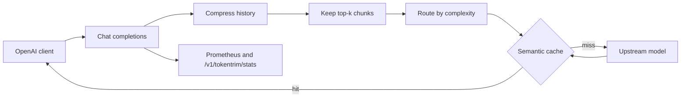

# TokenTrim

TokenTrim is an OpenAI-compatible proxy that sits in front of a chat model and cuts the tokens you pay for. It compresses prompts, trims retrieved context, routes easy questions to a cheaper model, and serves near-duplicate questions from a semantic cache.

The proxy speaks `POST /v1/chat/completions`. Point any OpenAI-style client at it and set the upstream base URL and API key with environment variables. No API key is required to try the local echo upstream.



## What happens to a request

1. **Count the naive prompt.** Inline `<document>` / `<context>` blocks and any `tokentrim.documents` are included, because that is the text that would have been pasted into the model.
2. **Compress.** Whitespace outside code fences is collapsed, stock assistant filler is removed, and old turns past the history budget are replaced with a short extractive summary. The latest message is never dropped.
3. **Trim context.** Documents are chunked and scored against the latest user question. Only the top chunks that fit the RAG budget are attached.
4. **Route.** A local complexity score picks a model from `tokentrim.routing.routes`. Length alone stays on the cheap model; proof, code, and analysis cues move the request up. Set `tokentrim.routing.honor-requested-model=true` to keep the client's model.
5. **Cache.** The latest user question is embedded. The same instructions plus a near-duplicate question return the stored completion and send **zero** tokens upstream. A different system prompt does not share the entry.
6. **Call upstream** on a miss, store the answer, and record tokens, estimated dollars, latency, and the cache result.

Savings headers on every response:

| Header | Meaning |
| --- | --- |
| `X-TokenTrim-Cache` | `HIT`, `MISS`, or `BYPASS` |
| `X-TokenTrim-Model` | Model that answered or would answer |
| `X-TokenTrim-Requested-Model` | Model the client asked for |
| `X-TokenTrim-Route` | Route name (`simple`, `complex`, `requested`, `forced`) |
| `X-TokenTrim-Tokens-Original` | Tokens in the untouched prompt |
| `X-TokenTrim-Tokens-Sent` | Tokens actually sent (`0` on a hit) |
| `X-TokenTrim-Tokens-Saved` | Original minus sent, floored at zero |
| `X-TokenTrim-Cost-Saved-Usd` | Estimated dollars versus the requested model |
| `X-TokenTrim-Rag-Chunks` | How many context chunks were attached |
| `X-TokenTrim-Quality` | Present only when a quality check ran |

Token totals use [JTokkit](https://github.com/knuddelsgmbh/jtokkit) (`cl100k_base` by default) plus the usual chat-message overhead. They are stable for comparisons. A provider's own usage field can differ by a few tokens.

## Run it locally

Java 21 and Maven 3.9+ (or the included `./mvnw`).

```bash
cp .env.example .env
TOKENTRIM_UPSTREAM_MODE=echo ./mvnw spring-boot:run
```

Echo mode returns `Echo: <latest user question>` and still runs compression, routing, caching, and accounting. Use it to reproduce the demo without a key.

A real upstream:

```bash
export TOKENTRIM_UPSTREAM_MODE=http
export TOKENTRIM_UPSTREAM_BASE_URL=https://api.openai.com/v1
export TOKENTRIM_UPSTREAM_API_KEY=sk-...
./mvnw spring-boot:run
```

The base URL should include `/v1`. TokenTrim appends `/chat/completions`. Optional `TOKENTRIM_PROXY_API_KEY` requires `Authorization: Bearer <key>` on `/v1/**`. Actuator and `/healthz` stay open; do not publish them on an open network.

### Example

```bash
curl -sD - http://localhost:8080/v1/chat/completions \
  -H 'Content-Type: application/json' \
  --data @samples/verbose-request.json
```

First call against echo mode, default settings:

```text
HTTP/1.1 200
X-TokenTrim-Cache: MISS
X-TokenTrim-Model: gpt-4o-mini
X-TokenTrim-Requested-Model: gpt-4o
X-TokenTrim-Route: simple
X-TokenTrim-Tokens-Original: 342
X-TokenTrim-Tokens-Sent: 270
X-TokenTrim-Tokens-Saved: 72
X-TokenTrim-Cost-Saved-Usd: 0.00089910
X-TokenTrim-Rag-Chunks: 2
```

The body is a normal chat completion (`{"object":"chat.completion", ...}`). Send the same body again:

```text
X-TokenTrim-Cache: HIT
X-TokenTrim-Tokens-Sent: 0
X-TokenTrim-Tokens-Saved: 342
X-TokenTrim-Cache-Similarity: 1.0000
```

`samples/hard-request.json` is scored as complex (`X-TokenTrim-Route: complex`, `X-TokenTrim-Model: gpt-4o`) even though the client asked for `gpt-4o-mini`.

A paraphrase of the cached question, with the **same** system prompt, is also a hit. `Tell me the capital city of France` came back with `X-TokenTrim-Cache: HIT` and `X-TokenTrim-Cache-Similarity: 0.8227` after the sample above. `What is the capital of Germany?` is below the threshold and misses. The cache does not reuse an answer across different system prompts.

Other endpoints:

```bash
curl -s http://localhost:8080/v1/tokentrim/stats
curl -s http://localhost:8080/v1/models
curl -s http://localhost:8080/healthz
curl -s http://localhost:8080/actuator/prometheus | head
```

`stream: true` is rejected. The proxy measures and caches full completions.

Request extension (stripped before the upstream call):

```json
{
  "model": "gpt-4o",
  "messages": [{"role": "user", "content": "What is the capital of France?"}],
  "tokentrim": {
    "documents": ["full document text..."],
    "skip_cache": false,
    "skip_compression": false,
    "quality_check": false,
    "force_model": null,
    "history_token_budget": 512,
    "rag_top_k": 2
  }
}
```

You can also wrap pasted context in `<document>...</document>` or `<context>...</context>` inside a message. Those blocks are removed from the prompt and scored as chunks.

## Benchmark

`TokenSavingsBenchmarkTest` builds a long system prompt, eight bloated turns, and four documents (one relevant). It then tightens the history budget to 512 and the RAG budget to 320, which is stricter than the defaults, and checks the floor below.

```bash
./mvnw -Dtest=TokenSavingsBenchmarkTest -Dsurefire.useFile=false test
```

```text
TokenTrim benchmark
original tokens : 5303
sent tokens     : 796
tokens saved    : 4507 (85.0%)
estimated USD   : 0.013223
route           : simple -> gpt-4o-mini
rag chunks      : 2
repeat cache    : HIT
upstream calls  : 2
hard route      : complex -> gpt-4o
```

The repeat is a cache hit, so the upstream is called once for the verbose prompt and once for a separate hard prompt. The test fails if savings drop under 50%, if the repeat is not a hit, or if routing flips.

With the **default** budgets the same fixture still removes about 73% of the prompt (5303 original, 1438 sent) before the cache makes the repeat free. The small `samples/verbose-request.json` file saves less on the first call because most of its history already fits; the second call is the free one.

`scripts/benchmark.sh` curls a running server twice and prints the stats payload.

Prices are the estimates in `TokenTrimProperties` (gpt-4o at $2.50 / $10.00 per million input / output tokens, gpt-4o-mini at $0.15 / $0.60). Override `tokentrim.pricing.models` when those change. A cache hit costs nothing for that request. An optional quality check is extra spend and is **not** subtracted from the savings figure.

## Dependencies

```bash
docker compose up -d
```

| Service | Port | Used when |
| --- | --- | --- |
| Redis 7 | 6379 | `TOKENTRIM_CACHE_BACKEND=redis` |
| Postgres + pgvector (`pgvector/pgvector:pg17`) | 5432 | `TOKENTRIM_CACHE_BACKEND=pgvector` |
| Prometheus | 9090 | Scrapes `host.docker.internal:8080/actuator/prometheus` |

The default backend is an in-process cache, so the app starts with nothing else running.

```bash
# Redis
export TOKENTRIM_CACHE_BACKEND=redis
export TOKENTRIM_REDIS_HOST=localhost

# pgvector. Dimensions must match the embedding width (256 for the hashing model).
# Drop tokentrim_cache if you change dimensions after the table exists.
export TOKENTRIM_CACHE_BACKEND=pgvector
export TOKENTRIM_PG_URL=jdbc:postgresql://localhost:5432/tokentrim
export TOKENTRIM_PG_USER=tokentrim
export TOKENTRIM_PG_PASSWORD=tokentrim
```

Redis stores each vector and scans the capped list in process (default 5,000 entries). pgvector ranks with cosine distance (`<=>`) and adds an HNSW index when the server allows it. Both are optional. The in-memory backend is what the tests and the echo demo use.

Prometheus metrics (Grafana-friendly names):

- `tokentrim_tokens_original_total`, `tokentrim_tokens_sent_total`, `tokentrim_tokens_saved_total`
- `tokentrim_cost_saved_usd_total`
- `tokentrim_cache_lookups_total{result="hit|miss|bypass"}`
- `tokentrim_routing_decisions_total{route,model}`
- `tokentrim_request_latency_seconds`, `tokentrim_upstream_latency_seconds`
- `tokentrim_quality_similarity`

```promql
sum(rate(tokentrim_tokens_saved_total[5m]))
sum(rate(tokentrim_cache_lookups_total{result="hit"}[5m]))
  / sum(rate(tokentrim_cache_lookups_total[5m]))
```

`/v1/tokentrim/stats` is the same story without a scraper: requests, hit rate, tokens, estimated dollars, average latency.

A container image is in the `Dockerfile` (`docker build -t tokentrim .`). Compose only starts the dependencies; run the jar on the host so Prometheus can scrape it through `host.docker.internal`.

## Configuration

Defaults live in `TokenTrimProperties` and `src/main/resources/application.yml`.

| Key | Default | Role |
| --- | --- | --- |
| `tokentrim.upstream.mode` | `http` | `http` or `echo` |
| `tokentrim.upstream.base-url` | `https://api.openai.com/v1` | Upstream origin, including `/v1` |
| `tokentrim.upstream.api-key` | empty | Bearer token for `http` mode |
| `tokentrim.security.proxy-api-key` | empty | If set, required on `/v1/**` |
| `tokentrim.compression.history-token-budget` | `768` | Budget for system + kept turns + summary |
| `tokentrim.cache.backend` | `memory` | `memory`, `redis`, or `pgvector` |
| `tokentrim.cache.similarity-threshold` | `0.72` | Cosine cutoff for a near duplicate |
| `tokentrim.cache.ttl` | `24h` | Entry lifetime |
| `tokentrim.embeddings.provider` | `hashing` | `hashing` or `openai` |
| `tokentrim.embeddings.dimensions` | `256` | Vector width. Must match pgvector |
| `tokentrim.routing.honor-requested-model` | `false` | `true` disables upgrading and downgrading |
| `tokentrim.rag.top-k` | `4` | Maximum chunks attached |
| `tokentrim.rag.token-budget` | `640` | Token cap for those chunks |
| `tokentrim.quality.enabled` | `false` | Allows sampled baseline comparisons |
| `tokentrim.quality.sample-rate` | `0` | Fraction of misses that also call the untouched prompt |

Routes, boilerplate phrases, and prices are Java defaults so a missing YAML key does not change behavior. Replace `tokentrim.routing.routes` to point at the model names your upstream actually serves. Routes are applied in ascending `max-complexity` order.

`tokentrim.embeddings.provider=openai` calls `POST /embeddings` on the same upstream with `text-embedding-3-small`. Set `dimensions` to the width that model returns before using pgvector.

`tokentrim.quality_check: true` on a request (or a non-zero sample rate with quality enabled) sends the original prompt as a second call and records the cosine similarity of the two answers in `X-TokenTrim-Quality`. Leave it off in production. It spends the tokens you were trying to save. The client still receives the optimized answer.

## Design tradeoffs

- **Extractive summaries, not another model call.** Old turns become `role: first sentence...`. The summary is deterministic and free. It is not as fluent as an LLM summary, and it can keep a detail you would rather have dropped. The latest user message is kept whole even when it blows the budget.
- **Heuristic routing.** Proof, code, and analysis phrases raise the score. A long but simple prompt stays on the small model, because length alone caps below the default `simple` cutoff of 0.40. This will mis-route some prompts. `honor-requested-model` and `tokentrim.force_model` are the escapes. Routing does not itself call a model.
- **Local hashing embeddings by default.** Words, a light bigram, and character trigrams, L2-normalized. Measured on the default 256-d model: identical questions after contraction folding score 1.0, "capital of France" vs "capital city of France" scores about 0.82, "capital of Germany" scores about 0.46, and a sourdough recipe scores about 0. The 0.72 threshold sits in that gap. It will miss paraphrases a neural model would catch, and it can false-hit short questions that share most of their content words. Switch the provider to `openai` when that matters. The cache stores whatever width you configure.
- **Cache key is the system prefix plus the latest user question.** Follow-ups such as "what about its population?" are different text, so they miss. Two users with different system prompts do not share an entry. Two users with the same instructions and a near-duplicate question do, which is the point and also the footgun if the answer depended on hidden history.
- **Redis is a capped linear scan.** Fine for a few thousand entries. pgvector is the path that actually indexes vectors. Neither is required to run.
- **In-flight duplicates can both miss.** Two identical requests at the same moment can both call upstream. Entries are replaced on write.
- **Tool calls and `n > 1` bypass the cache.** Compression and routing still run. Multimodal content parts are counted and preserved, not rewritten.
- **Quality comparison is a similarity of the two answers**, not a human grade. It is off unless you opt in.

## Tests and CI

```bash
./mvnw verify
```

Coverage includes whitespace and boilerplate compression, history budgeting, document extraction, embedding separation, cache hit / miss / TTL, routing, RAG top-k selection, savings math, the HTTP upstream client, and the `/v1/chat/completions` API (echo mode, cache, stats, Prometheus, proxy auth).

GitHub Actions (`.github/workflows/ci.yml`) runs `./mvnw verify` on Java 21. Redis and Postgres are not required there.

## Layout

```text
src/main/java/io/tokentrim
  api/            /v1/chat/completions, /v1/models, /v1/tokentrim/stats
  compress/       whitespace, boilerplate, history budget, document tags
  rag/            chunking and top-k selection
  embed/          hashing embedder and optional OpenAI embeddings
  cache/          memory, Redis, pgvector
  route/          complexity score and model choice
  pipeline/       one request, end to end
  upstream/       HTTP client and echo stand-in
  metrics/        Micrometer counters and the stats snapshot
docker-compose.yml
deploy/prometheus/prometheus.yml
samples/          curl fixtures
```

## License

MIT. See [LICENSE](LICENSE).
